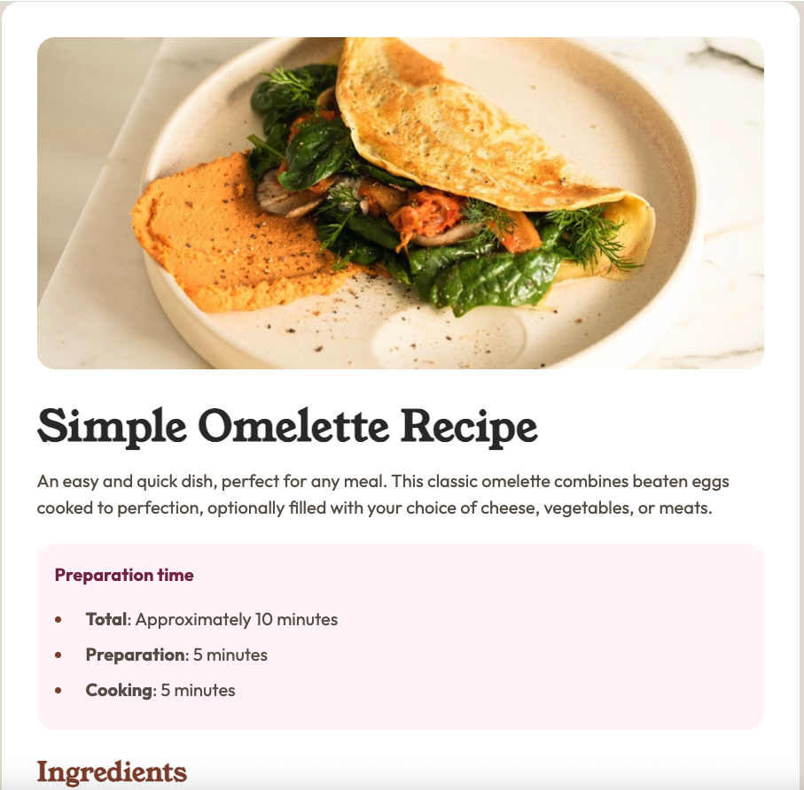

# Frontend Mentor - Recipe page solution

This is a solution to the [Recipe page challenge on Frontend Mentor](https://www.frontendmentor.io/challenges/recipe-page-KiTsR8QQKm). Frontend Mentor challenges help you improve your coding skills by building realistic projects. 

## Table of contents

- [Overview](#overview)
  - [The challenge](#the-challenge)
  - [Screenshot](#screenshot)
  - [Links](#links)
- [My process](#my-process)
  - [Built with](#built-with)
  - [What I learned](#what-i-learned)
  - [Continued development](#continued-development)
  - [Useful resources](#useful-resources)
  - [AI Collaboration](#ai-collaboration)
- [Author](#author)

**Note: Delete this note and update the table of contents based on what sections you keep.**

## Overview

### Screenshot




### Links

- Solution URL: [solution URL here](https://your-solution-url.com)
- Live Site URL: [live site URL here](https://gelo29.github.io/recipe-page/)

## My process

### Built with

- Semantic HTML5 markup
- CSS custom properties
- Flexbox
- Mobile-first workflow

**Note: These are just examples. Delete this note and replace the list above with your own choices**

### What I learned

Make use of clamp() for responsive font on any screen sizes

```css
body {
  min-height: 100vh;
  line-height: 1.5;
  font-size: clamp(1rem, 0.9rem + 0.5vw, 1.25rem);
  font-family: var(--font-outfit);
  display: flex;
  flex-direction: column;
  justify-content: center;
  align-items: center;
  color: var(--color-stone-600);
  background-color: var(--color-stone-150);
}
```
using media query to change layout when a breakpoint was hit
```css
@media (max-width: 40rem) {
  main {
    padding: 0;
  }
  article {
    margin: 0 2rem 0 2rem;
  }
  header img {
    border-radius: 0;
  }
}
```

### Continued development

I want to practice more on layouts flex and grids, Font sizes when to use px, rem, em etc. and also in responsive images.

### Useful resources

- [clamp in MDN](https://developer.mozilla.org/en-US/docs/Web/CSS/Reference/Values/clamp) - how clamp() works
- [Media query in MDN](https://developer.mozilla.org/en-US/docs/Web/CSS/Guides/Media_queries/Using) - how to use media queries

### AI Collaboration

I used Codex in Visual Studio code I use it as a guide in git commands and a mentor if I have something that I didn't understand like for example what is the difference between section and article, how box shadow works, how can I make the main container maintain its size to 400px even if I maximize the size of the window.

## Author

- Frontend Mentor - [Gelo](https://www.frontendmentor.io/profile/gelo29)
